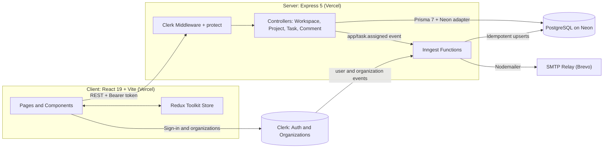
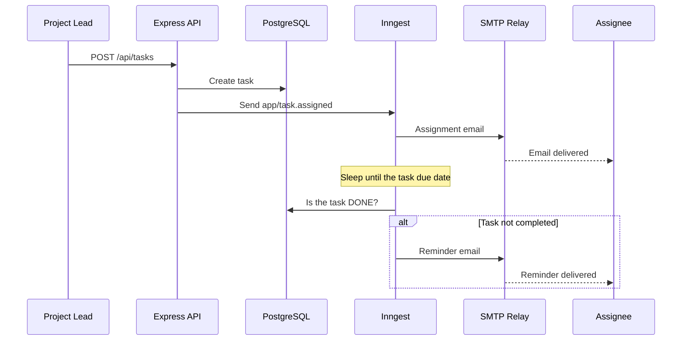
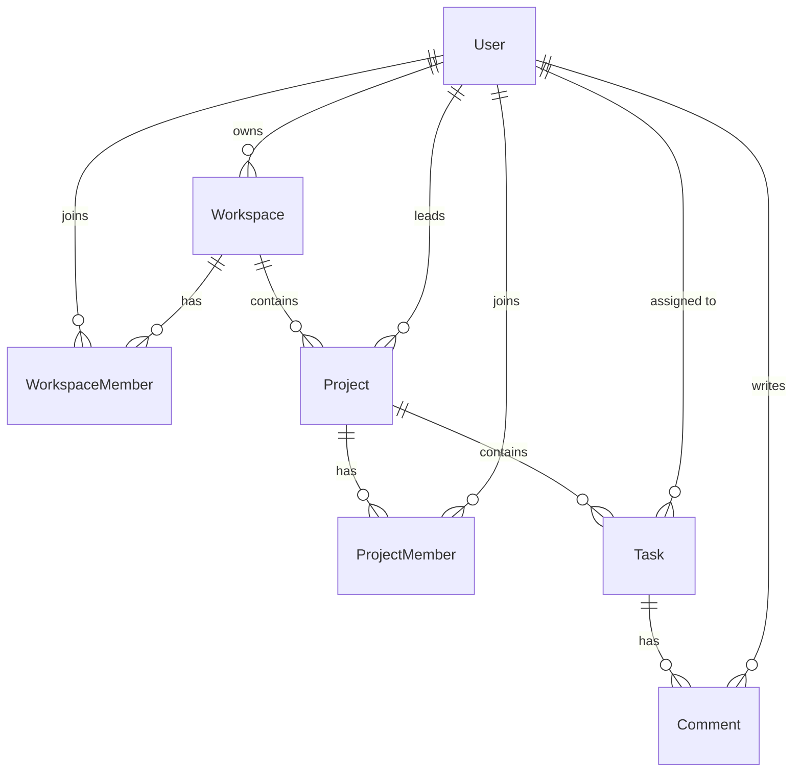

<div align="center">


# Planvio

**A full-stack, multi-workspace project management platform.**
Plan projects, assign tasks, track progress with analytics, and collaborate with your team, backed by event-driven automation.

<br />


<!--
  Add your live demo link here once deployed, for example:
  [**Live Demo**](https://your-planvio-app.vercel.app) · [**Report a Bug**](https://github.com/Ayush-verma25/Project_Management_App_PERN/issues)
-->

</div>

---

## Table of Contents

- [Overview](#overview)
- [Features](#features)
- [Tech Stack](#tech-stack)
- [System Architecture](#system-architecture)
- [Database Design](#database-design)
- [Roles and Permissions](#roles-and-permissions)
- [API Reference](#api-reference)
- [Background Jobs and Automation](#background-jobs-and-automation)
- [Project Structure](#project-structure)
- [Getting Started](#getting-started)
- [Environment Variables](#environment-variables)
- [Available Scripts](#available-scripts)
- [Deployment](#deployment)
- [Engineering Highlights](#engineering-highlights)
- [Roadmap](#roadmap)
- [Acknowledgements](#acknowledgements)
- [License](#license)
- [Author](#author)

---

## Overview

**Planvio** is a collaborative project management application built on the **PERN stack** (PostgreSQL, Express, React, Node.js). It is organised around **workspaces**: each workspace has its own members, projects, and tasks, and users can belong to several workspaces and switch between them instantly.

Inside a workspace, teams can create projects, assign typed and prioritised tasks with due dates, discuss work in per-task comment threads, view deadlines on a calendar, and monitor delivery health through live analytics. Assignees are notified by email when a task is assigned and are reminded automatically on the due date if the task is still open.

Authentication, organisation management, and invitations are handled by **Clerk**. Clerk events are mirrored into PostgreSQL by **Inngest** background functions, so the database always reflects the identity provider.

<!--
## Screenshots

Add screenshots of your app here, for example:

| Dashboard | Project Analytics |
| :---: | :---: |
|  |  |
-->

---

## Features

### Workspaces and Teams
- **Multiple workspaces**: create and switch between workspaces (Clerk Organizations); the last selected workspace is remembered across sessions.
- **Team management**: searchable member directory with roles (`ADMIN` / `MEMBER`), responsive as a table on desktop and cards on mobile.
- **Invitations**: invite people by email with a chosen role through Clerk's organisation invitations.

### Projects
- Create projects with a name, description, status, priority, start and end dates, a **project lead**, and a team.
- Five lifecycle statuses: `PLANNING`, `ACTIVE`, `ON_HOLD`, `COMPLETED`, `CANCELLED`.
- Search projects by name or description and filter by status and priority.
- Edit project details from a dedicated **Settings** tab; add members to an existing project.

### Tasks
- Task types: `TASK`, `BUG`, `FEATURE`, `IMPROVEMENT`, `OTHER`, each with its own icon and colour.
- Three-stage workflow: `TODO` → `IN_PROGRESS` → `DONE`, with `LOW` / `MEDIUM` / `HIGH` priority.
- Filter tasks by status, type, priority, and assignee; change status inline.
- **Bulk select and delete** tasks.
- Deep links to individual tasks (`/taskDetails?projectId=…&taskId=…`), also used in notification emails.

### Collaboration
- **Per-task discussion threads** with avatars and timestamps; the thread refreshes automatically every 10 seconds.
- **Email notifications** on assignment and an **automatic due-date reminder** if the task is not yet done.

### Insights and Planning
- **Dashboard** with workspace-level stats (total and completed projects, your tasks, overdue items), project overview, recent activity, and a tasks summary.
- **Project analytics**: completion rate, active tasks, overdue count, team size, plus charts for tasks by status (bar), by type (pie), and by priority (progress bars).
- **Calendar view**: monthly grid showing tasks per day, the next upcoming tasks, and highlighted overdue work.

### Experience
- Light and dark themes with the preference persisted.
- Fully responsive layout with a collapsible sidebar.
- Toast notifications for every action, plus loading, empty, and error states.
- Route-level code splitting for fast initial loads.

---

## Tech Stack

| Layer | Technologies |
| :--- | :--- |
| **Frontend** | React 19, Vite 7, React Router 7, Redux Toolkit, Tailwind CSS 4, Recharts, date-fns, Lucide React, React Hot Toast, Axios |
| **Backend** | Node.js (ES modules), Express 5, CORS, dotenv |
| **Database** | PostgreSQL on [Neon](https://neon.tech) via Prisma 7 with the Neon serverless driver adapter |
| **Authentication** | [Clerk](https://clerk.com) (`@clerk/react`, `@clerk/express`): sessions, JWT verification, Organizations |
| **Background jobs** | [Inngest](https://www.inngest.com): event-driven functions, durable steps, scheduled waits |
| **Email** | Nodemailer over SMTP (Brevo relay) |
| **Tooling** | ESLint 9, Nodemon |
| **Hosting** | Vercel (client and server deployed as separate projects) |

---

## System Architecture



**How it fits together**

1. The React app authenticates users with Clerk and attaches the session token to every API request.
2. Express verifies the session (`clerkMiddleware` + a `protect` guard) before any `/api/*` route runs.
3. Controllers enforce **role-based authorisation** and validate input, then read and write PostgreSQL through Prisma.
4. Identity changes in Clerk (users, organisations, memberships) flow to Inngest, which upserts them into the database, keeping Clerk as the source of truth.
5. Creating or reassigning a task emits an event that triggers a durable email-and-reminder workflow.

### Task assignment workflow



---

## Database Design

The schema is defined in [`server/prisma/schema.prisma`](server/prisma/schema.prisma).



| Model | Purpose | Notes |
| :--- | :--- | :--- |
| `User` | Mirror of a Clerk user | Primary key is the Clerk user ID; unique email |
| `Workspace` | Mirror of a Clerk organisation | Unique `slug`; JSON `settings`; has an owner |
| `WorkspaceMember` | Membership with a role (`ADMIN` / `MEMBER`) | Unique on `(userId, workspaceId)` |
| `Project` | Unit of work inside a workspace | Status, priority, dates, `progress` (0–100), `team_lead` |
| `ProjectMember` | Project team membership | Unique on `(userId, projectId)` |
| `Task` | Work item inside a project | Type, status, priority, assignee, due date |
| `Comment` | Discussion message on a task | Ordered by creation time |

**Enums:** `WorkspaceRole`, `TaskStatus`, `TaskType`, `ProjectStatus`, `Priority`.
All relations use `onDelete: Cascade`, so removing a user, workspace, project, or task cleans up its dependents.

---

## Roles and Permissions

Authorisation is enforced **on the server** in every controller, not just hidden in the UI.

| Action | Workspace Admin | Project Lead | Project Member |
| :--- | :---: | :---: | :---: |
| View workspaces they belong to | ✅ | ✅ | ✅ |
| Create a project | ✅ | n/a | ❌ |
| Edit project details (name, status, dates, priority, progress) | ✅ | ✅ | ❌ |
| Change project lead or reassign the project team | ✅ | ❌ | ❌ |
| Add a member to a project | ❌ | ✅ | ❌ |
| Create, update, or delete tasks | ❌ | ✅ | ❌ |
| Read and post task comments | ❌ | ✅ | ✅ |

Additional rules enforced by the API: the project lead and all project members must belong to the workspace, task assignees must belong to the project, projects cannot be moved between workspaces, and end dates cannot precede start dates.

---

## API Reference

All `/api/*` routes (except the Inngest endpoint) require a valid Clerk session token: `Authorization: Bearer <token>`.

| Method | Endpoint | Description |
| :---: | :--- | :--- |
| `GET` | `/` | Health check |
| `GET` | `/api/workspaces` | List the user's workspaces with members, projects, tasks, and comments |
| `POST` | `/api/workspaces/add-member` | Add an existing user to a workspace by email (admin only) |
| `POST` | `/api/projects` | Create a project with its lead and team (admin only) |
| `PUT` | `/api/projects` | Update project details, lead, or team |
| `POST` | `/api/projects/:projectId/addMember` | Add a workspace member to a project (project lead only) |
| `POST` | `/api/tasks` | Create a task and trigger the assignment workflow (project lead only) |
| `PUT` | `/api/tasks/:id` | Update a task; re-triggers notification on reassignment (project lead only) |
| `POST` | `/api/tasks/delete` | Delete one or more tasks by ID (project lead only) |
| `POST` | `/api/comments` | Add a comment to a task |
| `GET` | `/api/comments/:taskId` | List a task's comments in chronological order |
| `ANY` | `/api/inngest` | Inngest function-serving endpoint |

**Example: create a task**

```http
POST /api/tasks
Authorization: Bearer <clerk-session-token>
Content-Type: application/json

{
  "projectId": "3f2b0c9e-…",
  "title": "Fix login redirect bug",
  "description": "Users are sent to / instead of their last page.",
  "type": "BUG",
  "priority": "HIGH",
  "status": "TODO",
  "assigneeId": "user_2abc…",
  "due_date": "2026-12-01"
}
```

---

## Background Jobs and Automation

Inngest functions live in [`server/inngest/index.js`](server/inngest/index.js) and are served at `/api/inngest`.

| Function | Trigger event | What it does |
| :--- | :--- | :--- |
| `sync-user-from-clerk` | `clerk/user.created` | Upserts the user (primary email, name, avatar) |
| `update-user-from-clerk` | `clerk/user.updated` | Updates profile fields |
| `delete-user-from-clerk` | `clerk/user.deleted` | Removes the user (cascades to related data) |
| `create-workspace-from-clerk` | `clerk/organization.created` | Creates the workspace and gives the creator `ADMIN` membership in one transaction |
| `update-workspace-from-clerk` | `clerk/organization.updated` | Syncs name, slug, and image |
| `delete-workspace-from-clerk` | `clerk/organization.deleted` | Removes the workspace |
| `create-workspace-member-from-clerk` | `clerk/organizationMembership.created` | Creates or updates the membership and role when an invitation is accepted |
| `send-task-assignment-mail` | `app/task.assigned` | Sends the assignment email, **sleeps until the due date**, re-checks the task, and sends a reminder if it is still not `DONE` |

User-supplied text in emails is HTML-escaped before rendering.

---

## Project Structure

```text
Project_Management_App_PERN/
├── client/                         # React + Vite frontend
│   ├── public/                     # Static assets (favicon)
│   ├── src/
│   │   ├── app/store.js            # Redux store configuration
│   │   ├── features/               # Redux slices (workspace, theme)
│   │   ├── configs/api.js          # Axios instance (VITE_BASE_URL)
│   │   ├── pages/                  # Route-level pages
│   │   │   ├── Layout.jsx          # Auth gate, workspace loading, shell
│   │   │   ├── Dashboard.jsx
│   │   │   ├── Projects.jsx
│   │   │   ├── ProjectDetails.jsx  # Tasks / Calendar / Analytics / Settings tabs
│   │   │   ├── TaskDetails.jsx     # Task info + discussion thread
│   │   │   └── Team.jsx
│   │   ├── components/             # Dialogs, charts, calendar, sidebar, navbar…
│   │   ├── App.jsx                 # Routes with lazy loading
│   │   └── main.jsx                # Clerk, Redux, and Router providers
│   ├── vercel.json                 # SPA rewrites
│   └── vite.config.js
│
├── server/                         # Express API
│   ├── config/                     # Prisma client (Neon adapter), Nodemailer
│   ├── controllers/                # workspace, project, task, comment logic
│   ├── routes/                     # Express routers
│   ├── middlewares/authMiddleware.js
│   ├── inngest/index.js            # Clerk sync + email workflow functions
│   ├── prisma/schema.prisma        # Data model
│   ├── prisma7.config.ts           # Prisma CLI configuration
│   ├── server.js                   # App entry point (Vercel-compatible export)
│   └── vercel.json
│
└── README.md
```

---

## Getting Started

### Prerequisites

- **Node.js** 20.19+ (or 22.12+) and **npm**
- A **[Neon](https://neon.tech) PostgreSQL** database (the data layer uses Prisma's Neon driver adapter)
- A **[Clerk](https://clerk.com)** application with **Organizations** enabled
- An **[Inngest](https://www.inngest.com)** account (for user and organisation sync and for emails)
- *(Optional)* SMTP credentials (e.g. Brevo) for task emails

### 1. Clone the repository

```bash
git clone https://github.com/Ayush-verma25/Project_Management_App_PERN.git
cd Project_Management_App_PERN
```

### 2. Configure environment variables

```bash
# macOS / Linux
cp server/.env.example server/.env
cp client/.env.example client/.env.local
```

```powershell
# Windows PowerShell
Copy-Item server\.env.example server\.env
Copy-Item client\.env.example client\.env.local
```

Fill in the values using the [Environment Variables](#environment-variables) reference below.

### 3. Set up the backend and database

```bash
cd server
npm install
npx prisma db push --config prisma7.config.ts   # local development only
npm run server                                  # http://localhost:5000
```

> The repository does not include Prisma migration files. `db push` is convenient for local prototyping; for production, establish and review a migration baseline instead (see [Deployment](#deployment)).

### 4. Start the frontend

In a second terminal:

```bash
cd client
npm install
npm run dev                                     # http://localhost:5173
```

### 5. Connect Clerk and Inngest

Users and workspaces are stored in your database **by Inngest functions reacting to Clerk events**, so this step is required for data to appear:

1. In Clerk, enable **Organizations**.
2. In the Inngest dashboard, add the **Clerk integration** so Clerk events are forwarded to Inngest.
3. Sync your Inngest app to the server's `/api/inngest` endpoint. For local development, run the Inngest Dev Server (`npx inngest-cli@latest dev -u http://localhost:5000/api/inngest`) or expose your server with a tunnel.

Once connected, sign up in the app, create a workspace, and start adding projects.

---

## Environment Variables

### Server (`server/.env`)

| Variable | Required | Description |
| :--- | :---: | :--- |
| `PORT` | No | API port (default `5000`) |
| `NODE_ENV` | No | `development` or `production`. In production, CORS is restricted to `CLIENT_URL` |
| `DATABASE_URL` | Yes | Neon PostgreSQL connection string |
| `CLERK_PUBLISHABLE_KEY` | Yes | Clerk publishable key |
| `CLERK_SECRET_KEY` | Yes | Clerk secret key |
| `CLIENT_URL` | Yes | Allowed browser origin(s), comma-separated; also used to build links in emails |
| `INNGEST_SIGNING_KEY` | Production | Verifies requests from Inngest |
| `INNGEST_EVENT_KEY` | Production | Authorises sending events (task assignment) to Inngest |
| `SMTP_USER` / `SMTP_PASS` | For emails | SMTP relay credentials |
| `SENDER_EMAIL` | For emails | "From" address for notifications |

### Client (`client/.env.local`)

| Variable | Required | Description |
| :--- | :---: | :--- |
| `VITE_CLERK_PUBLISHABLE_KEY` | Yes | Clerk publishable key |
| `VITE_BASE_URL` | Yes | Base URL of the API (e.g. `http://localhost:5000`) |

> Never commit real keys. `.env` files are already excluded by `.gitignore`; only `.env.example` files are tracked.

---

## Available Scripts

**Client** (`/client`)

| Command | Description |
| :--- | :--- |
| `npm run dev` | Start the Vite development server |
| `npm run build` | Create a production build |
| `npm run preview` | Preview the production build locally |
| `npm run lint` | Lint the codebase with ESLint |

**Server** (`/server`)

| Command | Description |
| :--- | :--- |
| `npm run server` | Start the API with Nodemon (auto-reload) |
| `npm start` | Generate the Prisma client and start the API |
| `npm exec prisma validate` | Validate the Prisma schema |

---

## Deployment

Planvio is set up for **Vercel**, deployed as two separate projects:

1. **Server**: import the repo with the root directory set to `server`. `server/vercel.json` routes all requests to the Express app, which exports itself instead of calling `listen()` when running on Vercel.
2. **Client**: import the repo with the root directory set to `client`. `client/vercel.json` rewrites all routes to `index.html` for client-side routing.
3. Set the **client** variables at build time, and the **server** variables in the server deployment. Set `CLIENT_URL` to the public client origin and `VITE_BASE_URL` to the public API origin.
4. Use the same Clerk application keys in both projects.
5. Configure Inngest to serve the server's `/api/inngest` endpoint, and add SMTP credentials if task emails are enabled.

> **Before production traffic:** the repository does not ship Prisma migrations. Provision the database, verify its schema matches `server/prisma/schema.prisma`, and establish a reviewed migration baseline rather than applying an unreviewed schema push.

---

## Engineering Highlights

- **Event-driven identity sync**: Clerk is the source of truth for users, organisations, and memberships; Inngest functions mirror those events into PostgreSQL using **idempotent upserts**, with workspace creation and creator-admin assignment wrapped in a transaction.
- **Durable workflows**: the task-assignment flow uses Inngest `step.run` and `step.sleepUntil` to send an email, wait until the due date, re-check the task's state, and conditionally send a reminder, with no cron jobs or queues to manage.
- **Server-side authorisation and validation**: every mutating endpoint checks role and membership and validates enums, dates, ranges, and relationships before touching the database.
- **Serverless-ready backend**: Prisma 7 with the Neon driver adapter over WebSockets, a reusable client instance, and an Express app that exports itself for Vercel while still running standalone locally.
- **Production-minded API hardening**: `x-powered-by` disabled, JSON body size limit, origin allow-list for CORS in production, and HTML-escaped email content.
- **Performance-conscious frontend**: lazy-loaded routes, a lazily loaded analytics tab, and a dedicated Clerk vendor chunk in the Vite build.
- **Predictable state management**: a Redux Toolkit slice holds the normalised workspace tree; the UI updates only after the API confirms a change, and failures surface through toasts.
- **Deep-linkable UI state**: project tabs and task views are encoded in the URL, so links from emails and bookmarks open the exact view.

---

## Roadmap

Planned improvements:

- [ ] Commit a Prisma migration baseline for reproducible database setup
- [ ] Add automated tests (unit and API integration) and a CI pipeline running lint, build, and `prisma validate`
- [ ] Replace comment polling with real-time updates (WebSockets or Server-Sent Events)
- [ ] Load workspace data incrementally with pagination instead of fetching the whole workspace tree at once
- [ ] Kanban board with drag-and-drop status changes
- [ ] File attachments and a persisted per-task activity log

---

## Acknowledgements

The frontend UI is built on top of the open-source [project-management](https://github.com/GreatStackDev/project-management) template by **GreatStackDev** (MIT licensed). This project extends it into a full PERN application with a custom Express/Prisma backend, Clerk authentication and organisations, Inngest-driven automation, email notifications, and Vercel deployment.

---

## License

The frontend is distributed under the **MIT License**. See [`client/LICENSE.md`](client/LICENSE.md) for details.

---

## Author

**Ayush Verma**

[](https://github.com/Ayush-verma25)

If you find this project useful, consider giving it a ⭐ on GitHub.
